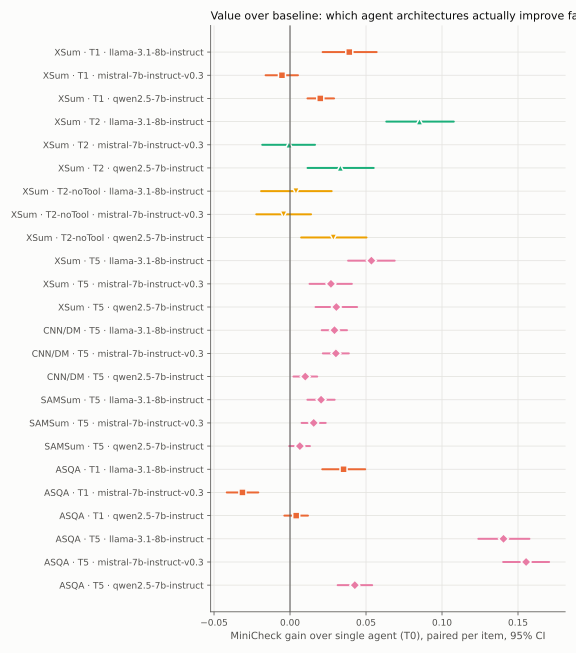
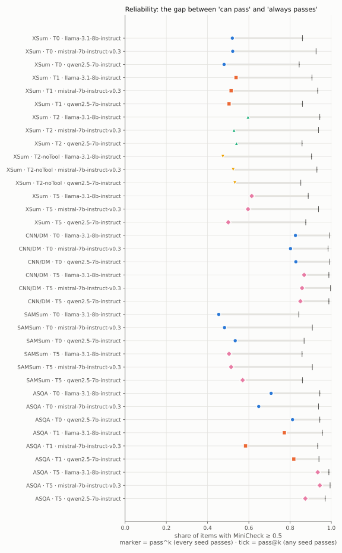

# Agent-Evals

**An evaluation suite for agentic LLM systems. It scores an agent's final output and also how the agent got there, how much it spent, and how reliably it succeeds.**

Most agent benchmarks report one number: did the final answer look right? Agent-Evals breaks evaluation into separate, reproducible evals. Each one answers its own question about the agent. All of them are computed from recorded runs, with validated judges, paired statistics and full provenance.

> **Systems under test:** single agent (T0, baseline) · Self-Refine agent (T1) · Critique-Revise agent (T2) · RL-trained agent (T5). Backbones used: Llama-3.1-8B, Mistral-7B-v0.3, Qwen2.5-7B (4-bit, one A10G GPU). Tasks: XSum, CNN/DM, SAMSum, ASQA. Each is run on 500 frozen items × 3 seeds.

---

## The eval suite

| # | Eval | Question it answers | What it measures |
|---|---|---|---|
| 1 | **Outcome** | Is the final output faithful to its evidence? | MiniCheck (headline), AlignScore, SummaC, FactCC; ROUGE-L and BERTScore for quality |
| 2 | **Grounding & citation** | Does the agent cite sources that actually support what it says? | citation recall and precision (ALCE), exact-match answer recall, on ASQA |
| 3 | **Reliability** | Does the agent succeed *every* time, or only sometimes? | pass@1, pass@k, **pass^k**, seed-to-seed SD, run-completion rate |
| 4 | **Trajectory** | What did the agent do to produce the answer? | LLM calls and rounds per task, self-termination rate, completion-cap rate, blank-output rate, per-call trace |
| 5 | **Efficiency** | What did the answer cost? | tokens and seconds per task, training GPU-hours |
| 6 | **Comparative** | Did the extra agent machinery pay off? | paired gain over baseline with 95% CI, token multiplier, gain per 1k extra tokens, Pareto frontier, break-even |
| 7 | **Ablation** | Which component is responsible for the gain? | the same agent with one component removed (T2 vs T2-noTool isolates the tool) |
| 8 | **Integrity** | Can the eval itself be trusted? | judge validation against human labels, worked-example leak checks, judge agreement, reward-exploitation check on held-out data |

### 1. Outcome evals: is the answer faithful?
Each output is checked against the evidence it was given (the article, the dialogue or the retrieved passages) by NLI-based fact-checking judges. **MiniCheck** is the headline judge, and every comparison is made on it. **AlignScore** serves as a second, independent judge. SummaC and FactCC are reported for continuity with summarization work, and ROUGE-L and BERTScore track whether faithfulness came at the expense of content. Outputs are scored in full, never cut short.

### 2. Grounding & citation evals: are the claims attributed?
On ASQA the agent must answer from 5 retrieved passages and cite them. **Citation recall** asks whether each sentence is supported by the passages it cites. **Citation precision** asks whether each cited passage is needed. **Exact-match recall** checks whether the gold short answers appear at all. Citation markers are removed before faithfulness scoring, so citing cannot inflate the other judges.

### 3. Reliability evals: does it succeed consistently?
An item *passes* when its headline score is ≥ 0.5. Over k = 3 seeds:
- **pass@1**: the expected pass rate of a single run.
- **pass@k**: the item passes on *at least one* seed, i.e. the agent *can* do it.
- **pass^k**: the item passes on *every* seed, i.e. the agent *reliably* does it (tau-bench style).
- **Consistency gap = pass@k − pass^k**: how much single-run accuracy overstates dependability.

Reliability also covers whether runs complete. Every launched run is recorded, and failed or out-of-memory attempts count against the **run-completion rate** instead of being quietly dropped.

### 4. Trajectory evals: what did the agent do?
Every model call is logged to `trace.jsonl` with its role, round, content, token count and finish reason. From these traces:
- **LLM calls and rounds per task**: how much work the agent did.
- **Self-termination rate**: how often a loop stopped on its own stop signal rather than running out of rounds. This shows whether the agent's own judgment controlled the loop.
- **Completion-cap rate** and **blank-output rate**: degenerate trajectories (runaway rewrites, empty answers).
- **Feedback diagnostics** (`run_analysis.py`): what form the agent's self-feedback takes, and how the score changes between the first draft and the final answer.

### 5. Efficiency evals: what did it cost?
Prompt, completion and total tokens per task, and wall-clock seconds per task, are measured on a single GPU. For a trained agent, the **GPU-hours** of its training run are traced from the adapter recorded in the run manifest. Training cost is reported separately and never hidden in per-request numbers.

### 6. Comparative evals: was it worth it?
Each agent is compared with the **single-agent baseline on the same backbone, task and items**:
- **Paired per-item gain** (seeds averaged per item) with a **95% bootstrap CI** (10,000 resamples). The verdict is *better*, *worse* or *no clear difference*, depending on whether the CI excludes 0.
- **Token and latency multipliers**, and **gain per 1k extra tokens**.
- **Pareto frontier**: configurations that no other configuration beats on both faithfulness and tokens.
- **Break-even**: the number of requests after which a one-time training cost is cheaper than running an inference-time loop on every request.

### 7. Ablation evals: which part made the difference?
An ablation runs the same agent, prompts, backbone and items with one component removed. **T2 vs T2-noTool** removes only the Critic's NLI tool, so the paired difference is the tool's own contribution, separate from the critique loop.

### 8. Integrity evals: can the eval be trusted?
An eval is only as good as its judge and its data, so the suite checks itself:
- **Judge validation**: MiniCheck and AlignScore must reproduce their published numbers on human-labelled data (LLM-AggreFact) before any run is scored (`validate_metrics.py`).
- **Judge agreement**: the training-reward judge and the evaluation judge are checked against each other (r ≈ 0.7), so an agent is never graded only by the judge it was trained to please.
- **Leak checks**: every output is scored for verbatim overlap with the prompt's worked examples, so copied text cannot count as faithfulness.
- **Reward-exploitation check** *(in progress)*: RL-trained agents are re-tested on held-out RAGTruth, which is never used for training or tuning. A gain that holds on the training task but not on held-out data indicates a gamed judge.

---

## How a system is evaluated

```
 run            trace              judge                 aggregate                 scorecard
 ───            ─────              ─────                 ─────────                 ─────────
 agent × model  every LLM call  →  validated judges   →  per item, per seed:    →  evals/SCORECARD.md
 × task × seed  logged with        score each output     pass@k / pass^k,          evals/leaderboard.csv
 on 500 frozen  role, tokens,      against its own       paired gain vs T0,        evals/scorecard.json
 items          finish reason      evidence              bootstrap CI, cost        evals/fig/*.svg
```

1. **Run**: `run_benchmark.py` runs an agent on frozen items and writes `results/<run_id>/`, which holds the resolved config, a manifest (git SHA, library versions, GPU, prompt-template versions, adapter hash), per-item `metrics.csv` and per-call `trace.jsonl`.
2. **Judge**: scoring runs as a separate phase on the saved outputs, so judges never influence generation.
3. **Aggregate**: `run_evals.py` collects every run. It scores the latest successful run per (agent, backbone, task, seed), counts all attempts toward reliability, and pairs items across agents.
4. **Report**: the scorecard tables and figures are regenerated from `results/`. They are never edited by hand.

## What makes these evals successful

| Property | How it is enforced |
|---|---|
| **Valid judges** | Judges are reproduced against human labels before use. Two independent judges are reported. |
| **Fair comparisons** | Every comparison is paired, on the same items, backbone and task, against a fixed baseline. |
| **Statistical honesty** | Bootstrap CIs are computed over items, 3 seeds per configuration, and "no clear difference" is a reported outcome. A pre-declared headline metric avoids metric-shopping. |
| **Reliability, not just accuracy** | pass^k and the consistency gap are reported next to the mean. Failed runs are counted, not dropped. |
| **Process visibility** | Full trajectories are logged, so *why* a score changed can be checked, not only *that* it changed. |
| **Cost awareness** | Every quality number has a token, latency or GPU-hour cost next to it. |
| **Causal attribution** | Ablations isolate individual components, such as the tool. |
| **Contamination & gaming checks** | Outputs are tested for worked-example leakage. The reward judge is kept separate from the evaluation judge. A held-out set is never trained on. |
| **Reproducibility** | Item samples are frozen, seeds and datasets/models are pinned to exact revisions, and every result traces to a run id and the SHA-256 of the file it was read from. |
| **Auditability** | Every eval design choice is recorded with its reason in an append-only decision log ([`src/docs/decisions.md`](src/docs/decisions.md)). |

---

## Results

From **108 scored runs** (147 launched) and **57 training runs**. Full tables: **[`evals/SCORECARD.md`](evals/SCORECARD.md)**.



| Eval | Finding |
|---|---|
| Comparative | The RL-trained agent beats the baseline in **11 / 12** configurations at **1.0×** tokens. Self-Refine wins only **3 / 6** and loses **1**, at **4.5–23×** tokens. |
| Ablation | The NLI tool carries the critic's gain: **+0.039** with the tool vs **+0.009** without it (XSum). It costs ~1.0× tokens but 3–5× latency. |
| Reliability | pass@k is **84–100%**, but pass^k is only **45–94%**, a mean consistency gap of **28 points**. On ASQA the RL agent lifts pass^k from **72% → 92%**. |
| Trajectory | Self-Refine's self-termination rate ranges from **1% to 99%** across backbones. Llama on ASQA almost never stops refining on its own and uses ~10 calls per task. |
| Efficiency | One RL training run (**33–58 GPU-h**) breaks even with the critic loop after **~13–14k requests**. |



---

## Running the evals

```bash
pip install -r requirements.txt && pip install -e .
pip install matplotlib                         # optional, for figures

python src/run_evals.py                        # score all runs in results/ -> evals/   (CPU, ~5 s)
python src/run_evals.py --pass-threshold 0.7   # stricter pass criterion
python src/validate_metrics.py ...             # integrity: reproduce judges on human labels
python src/run_analysis.py --config src/configs/analysis/asqa_diagnostics.yaml --set run.owner=<name>
                                               # trajectory / feedback diagnostics
python src/run_benchmark.py --topology all --backbone all --task tier1_xsum --set run.owner=<name>
                                               # produce new runs to evaluate (GPU)
pytest                                         # CPU test suite
```

## Where the evals live

```
evals/                         generated scorecard: SCORECARD.md, leaderboard.csv, scorecard.json, fig/
results/<run_id>/              raw eval records: manifest, per-item metrics, per-call trajectory
src/component/agent_evals/
  scorecard/                   reliability, trajectory, efficiency, comparative and ablation evals
  metrics/                     outcome, citation and leak-check judges + judge validation
  analysis/                    paired bootstrap, trajectory and feedback diagnostics
  datasets/                    frozen evaluation samples
  topologies/, agents/, rl/    the systems under test
src/docs/decisions.md          why every eval choice was made
```

