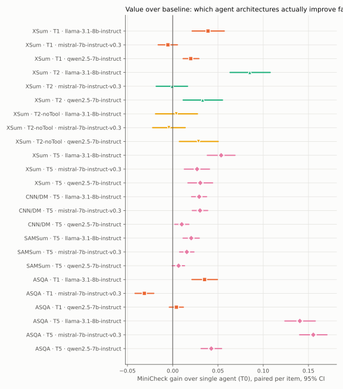
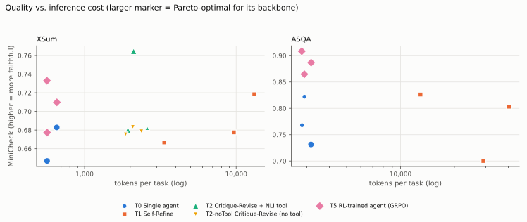
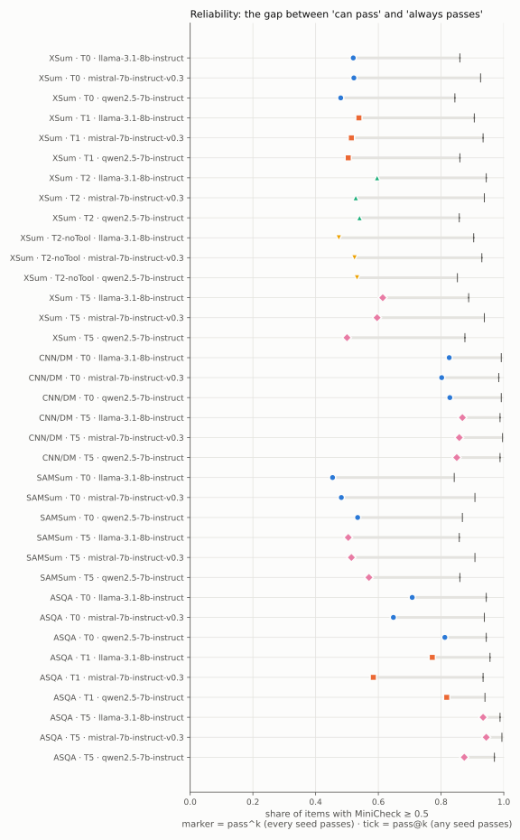

# Agentic Eval Scorecard

_Generated 2026-11-06 17:06 UTC by `src/run_evals.py` from 108 scored agent runs (147 launched) and 57 training runs in `results/`. Do not edit by hand._

Every agent configuration (architecture × backbone × task, over seeds) is scored on five dimensions: **outcome**, **reliability**, **trajectory**, **efficiency**, and **value over the single-agent baseline** (`t0_single_agent`). The headline judge is MiniCheck (faithfulness of the output to its grounding evidence). An item *passes* when its headline score is ≥ 0.5; `pass^k` requires all k seeds to pass. Intervals are 95% paired bootstrap over items (10,000 resamples, seed 123).

## 1. Architecture roll-up (across backbones)

### XSum — one-sentence news summary

| Agent | Architecture | Backbones | MiniCheck | pass^k | Calls/task | Tokens/task | Latency (s) | Gain vs T0 | Cost × | Better / same / worse |
|---|---|---|---|---|---|---|---|---|---|---|
| T0 | Single agent | 3 | 0.670 | 51% | 1.0 | 596 | 1.00 | – | – | – |
| T1 | Self-Refine | 3 | 0.688 | 52% | 4.1 | 8,727 | 4.35 | +0.018 | 14.6× | 2 / 1 / 0 |
| T2 | Critique-Revise + NLI tool | 3 | 0.709 | 55% | 3.0 | 2,209 | 12.52 | +0.039 | 3.7× | 2 / 1 / 0 |
| T2-noTool | Critique-Revise (no tool) | 3 | 0.679 | 51% | 3.0 | 2,105 | 3.02 | +0.009 | 3.5× | 1 / 2 / 0 |
| T5 | RL-trained agent (GRPO) | 3 | 0.707 | 57% | 1.0 | 596 | 1.14 | +0.037 | 1.0× | 3 / 0 / 0 |

### CNN/DM — multi-sentence news summary

| Agent | Architecture | Backbones | MiniCheck | pass^k | Calls/task | Tokens/task | Latency (s) | Gain vs T0 | Cost × | Better / same / worse |
|---|---|---|---|---|---|---|---|---|---|---|
| T0 | Single agent | 3 | 0.780 | 82% | 1.0 | 1,043 | 1.89 | – | – | – |
| T5 | RL-trained agent (GRPO) | 3 | 0.803 | 86% | 1.0 | 1,042 | 2.15 | +0.023 | 1.0× | 3 / 0 / 0 |

### SAMSum — dialogue summary

| Agent | Architecture | Backbones | MiniCheck | pass^k | Calls/task | Tokens/task | Latency (s) | Gain vs T0 | Cost × | Better / same / worse |
|---|---|---|---|---|---|---|---|---|---|---|
| T0 | Single agent | 3 | 0.603 | 49% | 1.0 | 280 | 1.19 | – | – | – |
| T5 | RL-trained agent (GRPO) | 3 | 0.618 | 53% | 1.0 | 280 | 1.37 | +0.014 | 1.0× | 2 / 1 / 0 |

### ASQA — grounded long-form QA with citations

| Agent | Architecture | Backbones | MiniCheck | pass^k | Calls/task | Tokens/task | Latency (s) | Gain vs T0 | Cost × | Better / same / worse |
|---|---|---|---|---|---|---|---|---|---|---|
| T0 | Single agent | 3 | 0.774 | 72% | 1.0 | 2,960 | 1.28 | – | – | – |
| T1 | Self-Refine | 3 | 0.776 | 72% | 6.6 | 27,462 | 10.07 | +0.003 | 9.3× | 1 / 1 / 1 |
| T5 | RL-trained agent (GRPO) | 3 | 0.887 | 92% | 1.0 | 2,957 | 1.41 | +0.113 | 1.0× | 3 / 0 / 0 |

## 2. Value over the single-agent baseline (per backbone)

| Task | Agent | Backbone | MiniCheck gain [95% CI] | Verdict | Items up / down | Δ pass^k | Token × | Gain per 1k extra tokens |
|---|---|---|---|---|---|---|---|---|
| XSum | T1 | llama-3.1-8b-instruct | +0.039 [+0.021, +0.057] | better | 47% / 44% | +0.018 | 23.3× | +0.0031 |
| XSum | T1 | mistral-7b-instruct-v0.3 | -0.005 [-0.016, +0.005] | no clear difference | 46% / 46% | -0.008 | 14.7× | -0.0006 |
| XSum | T1 | qwen2.5-7b-instruct | +0.020 [+0.012, +0.029] | better | 11% / 4% | +0.024 | 5.9× | +0.0071 |
| XSum | T2 | llama-3.1-8b-instruct | +0.085 [+0.063, +0.108] | better | 64% / 36% | +0.076 | 3.7× | +0.0553 |
| XSum | T2 | mistral-7b-instruct-v0.3 | -0.001 [-0.018, +0.016] | no clear difference | 49% / 51% | +0.006 | 3.9× | -0.0003 |
| XSum | T2 | qwen2.5-7b-instruct | +0.033 [+0.012, +0.055] | better | 55% / 44% | +0.060 | 3.4× | +0.0242 |
| XSum | T2-noTool | llama-3.1-8b-instruct | +0.004 [-0.019, +0.027] | no clear difference | 46% / 54% | -0.046 | 3.7× | +0.0026 |
| XSum | T2-noTool | mistral-7b-instruct-v0.3 | -0.004 [-0.022, +0.014] | no clear difference | 48% / 52% | +0.002 | 3.6× | -0.0025 |
| XSum | T2-noTool | qwen2.5-7b-instruct | +0.028 [+0.007, +0.050] | better | 55% / 44% | +0.052 | 3.3× | +0.0219 |
| XSum | T5 | llama-3.1-8b-instruct | +0.054 [+0.038, +0.069] | better | 65% / 34% | +0.094 | 1.0× | – |
| XSum | T5 | mistral-7b-instruct-v0.3 | +0.027 [+0.013, +0.041] | better | 57% / 43% | +0.074 | 1.0× | – |
| XSum | T5 | qwen2.5-7b-instruct | +0.030 [+0.017, +0.044] | better | 57% / 40% | +0.020 | 1.0× | – |
| CNN/DM | T5 | llama-3.1-8b-instruct | +0.029 [+0.021, +0.037] | better | 61% / 39% | +0.042 | 1.0× | – |
| CNN/DM | T5 | mistral-7b-instruct-v0.3 | +0.030 [+0.022, +0.039] | better | 63% / 37% | +0.056 | 1.0× | – |
| CNN/DM | T5 | qwen2.5-7b-instruct | +0.010 [+0.002, +0.018] | better | 55% / 45% | +0.022 | 1.0× | – |
| SAMSum | T5 | llama-3.1-8b-instruct | +0.020 [+0.011, +0.029] | better | 58% / 40% | +0.050 | 1.0× | – |
| SAMSum | T5 | mistral-7b-instruct-v0.3 | +0.016 [+0.008, +0.023] | better | 56% / 43% | +0.032 | 1.0× | – |
| SAMSum | T5 | qwen2.5-7b-instruct | +0.006 [-0.000, +0.013] | no clear difference | 53% / 45% | +0.036 | 1.0× | – |
| ASQA | T1 | llama-3.1-8b-instruct | +0.035 [+0.021, +0.049] | better | 57% / 42% | +0.064 | 14.4× | +0.0009 |
| ASQA | T1 | mistral-7b-instruct-v0.3 | -0.031 [-0.042, -0.021] | worse | 38% / 60% | -0.064 | 9.2× | -0.0012 |
| ASQA | T1 | qwen2.5-7b-instruct | +0.004 [-0.004, +0.012] | no clear difference | 19% / 12% | +0.006 | 4.5× | +0.0004 |
| ASQA | T5 | llama-3.1-8b-instruct | +0.140 [+0.124, +0.158] | better | 84% / 16% | +0.226 | 1.0× | – |
| ASQA | T5 | mistral-7b-instruct-v0.3 | +0.155 [+0.140, +0.170] | better | 86% / 14% | +0.296 | 1.0× | – |
| ASQA | T5 | qwen2.5-7b-instruct | +0.043 [+0.031, +0.054] | better | 64% / 29% | +0.062 | 1.0× | – |

## 3. Trajectory and reliability (per configuration)

| Task | Agent | Backbone | Seeds | MiniCheck ± seed SD | pass@1 | pass@k | pass^k | Calls/task | Self-stop | Len-cap | Runs completed | Pareto |
|---|---|---|---|---|---|---|---|---|---|---|---|---|
| XSum | T0 | llama-3.1-8b-instruct | 3 | 0.679 ± 0.004 | 70% | 86% | 52% | 1.00 | – | 0% | 3/3 |  |
| XSum | T0 | mistral-7b-instruct-v0.3 | 3 | 0.683 ± 0.003 | 75% | 93% | 52% | 1.00 | – | 0% | 3/3 | ★ |
| XSum | T0 | qwen2.5-7b-instruct | 3 | 0.647 ± 0.008 | 67% | 84% | 48% | 1.00 | – | 0% | 3/3 | ★ |
| XSum | T1 | llama-3.1-8b-instruct | 3 | 0.718 ± 0.006 | 75% | 91% | 54% | 6.08 | 66% | 0% | 9/9 |  |
| XSum | T1 | mistral-7b-instruct-v0.3 | 3 | 0.678 ± 0.005 | 74% | 93% | 51% | 4.00 | 87% | 0% | 12/12 |  |
| XSum | T1 | qwen2.5-7b-instruct | 3 | 0.667 ± 0.010 | 69% | 86% | 50% | 2.23 | 99% | 0% | 9/9 |  |
| XSum | T2 | llama-3.1-8b-instruct | 3 | 0.765 ± 0.019 | 79% | 94% | 60% | 3.00 | – | 0% | 3/3 | ★ |
| XSum | T2 | mistral-7b-instruct-v0.3 | 3 | 0.682 ± 0.019 | 76% | 94% | 53% | 3.00 | – | 0% | 3/3 |  |
| XSum | T2 | qwen2.5-7b-instruct | 3 | 0.680 ± 0.001 | 70% | 86% | 54% | 3.00 | – | 0% | 3/3 | ★ |
| XSum | T2-noTool | llama-3.1-8b-instruct | 3 | 0.683 ± 0.012 | 71% | 90% | 47% | 3.00 | – | 0% | 3/3 |  |
| XSum | T2-noTool | mistral-7b-instruct-v0.3 | 3 | 0.679 ± 0.020 | 75% | 93% | 52% | 3.00 | – | 0% | 3/3 |  |
| XSum | T2-noTool | qwen2.5-7b-instruct | 3 | 0.675 ± 0.004 | 69% | 85% | 53% | 3.00 | – | 0% | 3/3 |  |
| XSum | T5 | llama-3.1-8b-instruct | 3 | 0.733 ± 0.005 | 76% | 89% | 61% | 1.00 | – | 0% | 3/5 | ★ |
| XSum | T5 | mistral-7b-instruct-v0.3 | 3 | 0.710 ± 0.010 | 78% | 94% | 60% | 1.00 | – | 0% | 3/6 | ★ |
| XSum | T5 | qwen2.5-7b-instruct | 3 | 0.677 ± 0.009 | 70% | 88% | 50% | 1.00 | – | 0% | 3/5 | ★ |
| CNN/DM | T0 | llama-3.1-8b-instruct | 3 | 0.772 ± 0.009 | 92% | 99% | 83% | 1.00 | – | 0% | 3/6 | ★ |
| CNN/DM | T0 | mistral-7b-instruct-v0.3 | 3 | 0.775 ± 0.004 | 91% | 98% | 80% | 1.00 | – | 1% | 3/3 |  |
| CNN/DM | T0 | qwen2.5-7b-instruct | 3 | 0.793 ± 0.004 | 93% | 99% | 83% | 1.00 | – | 0% | 3/3 | ★ |
| CNN/DM | T5 | llama-3.1-8b-instruct | 3 | 0.802 ± 0.001 | 94% | 99% | 87% | 1.00 | – | 0% | 3/3 | ★ |
| CNN/DM | T5 | mistral-7b-instruct-v0.3 | 3 | 0.806 ± 0.002 | 94% | 100% | 86% | 1.00 | – | 1% | 3/3 | ★ |
| CNN/DM | T5 | qwen2.5-7b-instruct | 3 | 0.803 ± 0.005 | 93% | 99% | 85% | 1.00 | – | 0% | 3/3 | ★ |
| SAMSum | T0 | llama-3.1-8b-instruct | 3 | 0.582 ± 0.010 | 66% | 84% | 45% | 1.00 | – | 0% | 3/5 |  |
| SAMSum | T0 | mistral-7b-instruct-v0.3 | 3 | 0.603 ± 0.006 | 70% | 91% | 48% | 1.00 | – | 1% | 3/3 |  |
| SAMSum | T0 | qwen2.5-7b-instruct | 3 | 0.625 ± 0.003 | 71% | 87% | 53% | 1.00 | – | 0% | 3/3 | ★ |
| SAMSum | T5 | llama-3.1-8b-instruct | 3 | 0.602 ± 0.014 | 69% | 86% | 50% | 1.00 | – | 0% | 3/3 | ★ |
| SAMSum | T5 | mistral-7b-instruct-v0.3 | 3 | 0.619 ± 0.003 | 72% | 91% | 51% | 1.00 | – | 1% | 3/3 | ★ |
| SAMSum | T5 | qwen2.5-7b-instruct | 3 | 0.631 ± 0.002 | 73% | 86% | 57% | 1.00 | – | 0% | 3/3 | ★ |
| ASQA | T0 | llama-3.1-8b-instruct | 3 | 0.768 ± 0.007 | 84% | 94% | 71% | 1.00 | – | 0% | 3/6 |  |
| ASQA | T0 | mistral-7b-instruct-v0.3 | 3 | 0.731 ± 0.016 | 81% | 94% | 65% | 1.00 | – | 0% | 3/3 | ★ |
| ASQA | T0 | qwen2.5-7b-instruct | 3 | 0.822 ± 0.003 | 88% | 94% | 81% | 1.00 | – | 0% | 3/3 |  |
| ASQA | T1 | llama-3.1-8b-instruct | 3 | 0.803 ± 0.004 | 88% | 96% | 77% | 9.96 | 1% | 0% | 3/3 |  |
| ASQA | T1 | mistral-7b-instruct-v0.3 | 3 | 0.700 ± 0.014 | 79% | 93% | 58% | 6.47 | 62% | 6% | 3/3 |  |
| ASQA | T1 | qwen2.5-7b-instruct | 3 | 0.826 ± 0.004 | 88% | 94% | 82% | 3.42 | 85% | 0% | 3/3 |  |
| ASQA | T5 | llama-3.1-8b-instruct | 3 | 0.908 ± 0.008 | 96% | 99% | 93% | 1.00 | – | 0% | 3/3 | ★ |
| ASQA | T5 | mistral-7b-instruct-v0.3 | 3 | 0.887 ± 0.008 | 98% | 99% | 94% | 1.00 | – | 0% | 3/3 | ★ |
| ASQA | T5 | qwen2.5-7b-instruct | 3 | 0.865 ± 0.003 | 92% | 97% | 87% | 1.00 | – | 0% | 3/6 | ★ |

_Self-stop_: share of tasks where a refinement loop ended on its own stop signal rather than its round budget (undefined for single calls and fixed-length loops). _Len-cap_: share of tasks where a call hit the completion cap. _Pareto_ ★: no other configuration on the same task and backbone is at least as faithful for fewer tokens (inference cost only).

## 4. Tool-use ablation: does the Critic's NLI tool help?

Critique-Revise with the NLI fact-checking tool against the identical loop with the tool removed.

| Task | Backbone | MiniCheck gain from tool [95% CI] | Verdict | Latency × | Token × |
|---|---|---|---|---|---|
| XSum | llama-3.1-8b-instruct | +0.081 [+0.064, +0.099] | better | 3.14× | 1.01× |
| XSum | mistral-7b-instruct-v0.3 | +0.004 [-0.012, +0.019] | no clear difference | 4.57× | 1.09× |
| XSum | qwen2.5-7b-instruct | +0.005 [+0.001, +0.009] | better | 5.10× | 1.04× |

## 5. Train once or orchestrate every time? (RL break-even)

Requests after which the one-time GPU cost of training the RL agent is repaid by not running an inference-time loop (wall clock per request taken as GPU time; sequential serving). _Transfer_: the adapter was trained on a different task.

| Task | Backbone | vs loop | Training GPU-h | Transfer | Loop extra s/request | Break-even requests | RL ≥ loop quality? |
|---|---|---|---|---|---|---|---|
| XSum | llama-3.1-8b-instruct | T1 | 36.1 | no | 5.25 | 24,783 | yes |
| XSum | llama-3.1-8b-instruct | T2 | 36.1 | no | 9.70 | 13,408 | no |
| XSum | llama-3.1-8b-instruct | T2-noTool | 36.1 | no | 2.44 | 53,351 | yes |
| XSum | mistral-7b-instruct-v0.3 | T1 | 58.0 | no | 3.98 | 52,480 | yes |
| XSum | mistral-7b-instruct-v0.3 | T2 | 58.0 | no | 16.23 | 12,855 | yes |
| XSum | mistral-7b-instruct-v0.3 | T2-noTool | 58.0 | no | 2.33 | 89,435 | yes |
| XSum | qwen2.5-7b-instruct | T1 | 33.0 | no | 0.41 | 292,253 | yes |
| XSum | qwen2.5-7b-instruct | T2 | 33.0 | no | 8.21 | 14,482 | no |
| XSum | qwen2.5-7b-instruct | T2-noTool | 33.0 | no | 0.88 | 135,447 | yes |
| ASQA | llama-3.1-8b-instruct | T1 | 39.5 | no | 14.27 | 9,975 | yes |
| ASQA | mistral-7b-instruct-v0.3 | T1 | 49.6 | no | 9.56 | 18,689 | yes |
| ASQA | qwen2.5-7b-instruct | T1 | 35.1 | no | 2.16 | 58,625 | yes |

## Figures

## Provenance

Each configuration is scored from the latest successful run per seed; superseded and failed attempts are counted under reliability but never scored. Run ids and the SHA-256 of every `metrics.csv` read are in `scorecard.json` under `cells[].provenance`.
